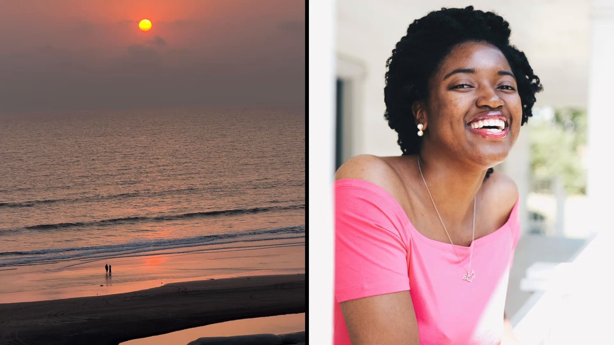
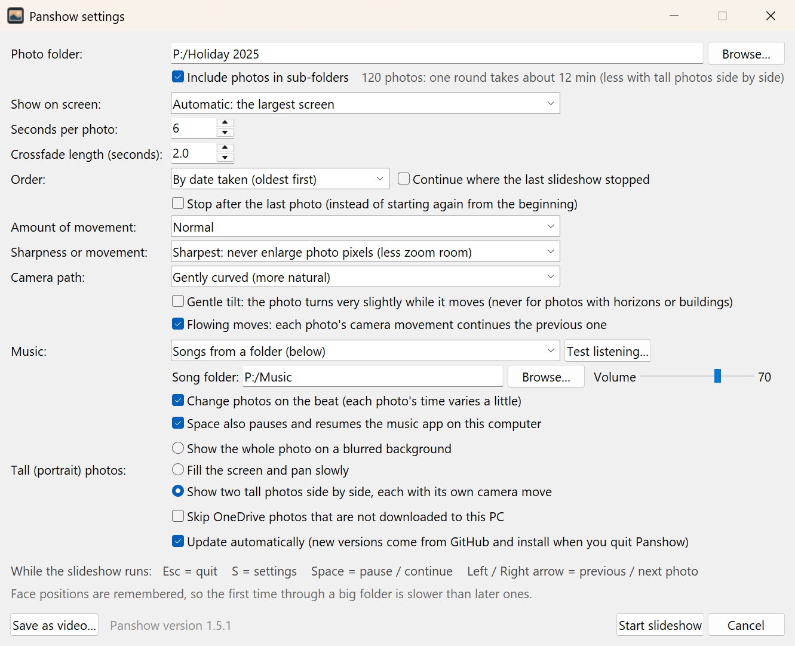

# Panshow

A full-screen **pan & zoom photo slideshow** for Windows. Every photo gets a slow, smooth camera
move (the "Ken Burns effect"), drawn live by the graphics card, so it stays sharp and smooth
even on a 4K screen. When a photo has faces in it, the camera moves towards them; photos
without faces get a gentle move towards their most interesting part.


| Aims at faces | Two tall photos side by side | Pets too |
|---|---|---|
|  |  |  |

*Made by Panshow itself ("Save as video"). Photos: see [docs/CREDITS.md](docs/CREDITS.md).*

## Download and install

Download **Panshow-Setup-x.y.z.exe** from the
[Releases page](https://github.com/jakentta/panshow/releases/latest) and run it.
It installs for your own Windows account; no administrator rights are needed.

Windows may say *"Windows protected your PC"*, because Panshow is not signed by a paid
certificate. Click **More info**, then **Run anyway**.

Needs Windows 10 or 11 (64-bit).

All versions stay available: older ones can be downloaded from the
[list of all releases](https://github.com/jakentta/panshow/releases).

## Using it

The first time, the settings window opens: choose your photo folder and press
**Start slideshow**. After that Panshow starts the slideshow straight away.

| Key | What it does |
|---|---|
| Esc | quit |
| S | settings |
| Space | pause / continue |
| Left / Right arrow | previous / next photo |

Only the photos are shown, with no text and no mouse pointer. Photos are shown in random order:
every photo once before any comes again.



Settings include: photo folder (Panshow shows how many photos it found and how long one round
takes), which screen to use (automatically the biggest one), seconds per
photo, crossfade length (in 0.1 s steps), order (shuffled, by date taken or by name; continue
where it stopped; stop after the last photo), amount of movement, sharpness versus movement,
camera path (gently curved or straight), gentle tilt, flowing moves, two energetic movement
styles: **Wild** (fast moves, big tilts, quick cuts) and **Hyperdrive** (even faster, with gentle
zoom pulses on the beat), how to show tall
(portrait) photos (on a blurred background, filling the screen, or **two side by side**, each
with its own camera move), and **music**, with the option to change photos on the beat (the time per
photo then varies by at most 15%). Music can be songs from a folder (mp3, flac, wav, ogg), or
Panshow can **listen** to what the computer plays (Spotify, YouTube Music, web radio... in their
own apps) or through the microphone (music from another speaker) and follow that beat live.

**Save as video:** the settings window can also make an MP4 video of the slideshow (4K or
Full HD, 60 frames per second), with your own songs (mp3, flac, wav, ogg) built in and the photo
changes on their beats. The length follows the music, is "every photo once", or is set in minutes. Music from streaming
services cannot be put into a video; their apps do not hand out the songs. Videos are made
with Windows' own H.264/AAC encoder (about 300 MB per minute in 4K, 100 MB in Full HD).

**Tip for a TV or second screen:** press Win+P and choose *Extend* or *Second screen only*.
In *Duplicate* mode Windows gives both screens the same (smaller) resolution, so a 4K screen
would not get a real 4K picture.

## How the camera works

- Faces are found on your own computer (OpenCV YuNet), and so are pets, other animals and
  people seen without their face (YOLOX). The camera pushes in or pulls out on a face or pet,
  frames a group, or drifts from one to another. With *flowing moves*, each photo's movement
  continues the previous one, so the crossfades feel like one camera move. Faces sit near the rule-of-thirds
  lines with room above them, and are never cut by the edge of the frame at the start or end of
  a move.
- Zoom changes at an even pace to the eye (logarithmic), moves ease in and out gently, and they
  overlap the crossfades so the picture never stops and restarts.
- The camera travels on a gentle arc (or straight, if you prefer), and can optionally turn the
  photo very slightly (under one degree) while it moves. Photos with horizons or buildings are
  never tilted, because they would look crooked.
- Photos are never enlarged beyond their real pixels unless you allow it, so they stay sharp.
- The next photo is prepared in a separate background process, so loading never makes the
  motion stutter.

## Updates

Panshow checks GitHub for a newer version about a minute after it starts, downloads it in the
background, and installs it quietly when you quit. Every update is digitally signed; Panshow
refuses anything without a valid signature. If a new version does not start properly, Panshow
goes back to the previous one. Automatic updates can be switched off in the settings.

## Privacy

- Your photos never leave your computer.
- Settings and remembered face positions are stored only on your computer
  (`%APPDATA%\Panshow` and `%LOCALAPPDATA%\Panshow`).
- When Panshow listens to the computer's sound or the microphone, the sound is only analysed
  on the fly to find the beat; it is never recorded, stored or sent anywhere.
- The only internet connection is the update check, which asks GitHub for the latest version
  file. Nothing about you or your photos is sent (GitHub sees your IP address, as with any web
  request). Switch automatic updates off to stop it.

## Source code and licence

Panshow is open source under the [MIT licence](LICENSE): you may use, change and share it, also in
your own programs, as long as the licence text stays with it. The source code is in this
repository. Panshow was written with the help of the AI assistant Claude, directed by its owner.

The program is built with open-source components (Python, OpenCV, NumPy, Pillow, pi-heif/libheif,
moderngl, GLFW, cryptography, libsndfile, PortAudio and others); their licences are in
`THIRD-PARTY-NOTICES.txt` in the program folder.

Found a problem or have an idea? Please open an
[issue](https://github.com/jakentta/panshow/issues). Describe what you did, what happened, and
your Windows version and graphics chip. The log file
`%LOCALAPPDATA%\Panshow\panshow.log` often shows what went wrong (look through it for anything
personal, such as file names, before you post it).

## Code signing policy

The installer is not signed yet, which is why Windows may show the "Windows protected your PC"
message above. Panshow is meant to use the free signing offered to open-source projects by the
SignPath Foundation; if it is accepted, releases will carry:

> Free code signing provided by [SignPath.io](https://about.signpath.io), certificate by
> [SignPath Foundation](https://signpath.org).

- **Committers and reviewers:** [jakentta](https://github.com/jakentta)
- **Approvers:** [jakentta](https://github.com/jakentta)
- **Privacy:** see [Privacy](#privacy) above. Panshow contacts the internet only for its update
  check, which can be switched off in the settings.

Panshow's automatic updates have their own, separate signature (Ed25519), which installed copies
check before they install anything. See [ARCHITECTURE.md](ARCHITECTURE.md).

## For developers

How it works inside: [ARCHITECTURE.md](ARCHITECTURE.md).

You need Windows 10 or 11 and Python 3.14. Set up the Python environment once:

```powershell
python -m venv .venv
```

```powershell
.venv\Scripts\python.exe -m pip install -r requirements.txt
```

Run from source:

```powershell
.venv\Scripts\python.exe Panshow.py
```

Build the program and the installer (needs [Inno Setup 6](https://jrsoftware.org/isinfo.php); the
result is in `dist\`):

```powershell
powershell -ExecutionPolicy Bypass -File build.ps1
```

The same build runs on GitHub's own computers for every change (see the **Actions** tab), so a
released installer can be traced back to this source code.

Make a signed release (only the maintainer, who holds the update-signing key; `--publish` uploads
it to GitHub):

```powershell
.venv\Scripts\python.exe tools\release.py --notes "What is new"
```

Test options: `--window 1600x900`, `--sim 3840x2160` (draw at 4K into a window),
`--seconds 30` (stop and print timing), `--folder PATH`, `--keys "5:right,8:left"`.
Tests: `tools\test_planner.py`, `tools\test_kicks.py`, `tools\test_beats.py`,
`tools\test_order.py <scratch folder>`, `tools\test_update.py <scratch folder>`,
`tools\test_video.py` (needs PyAV as a test-only reader), `tools\check_deps.py dist\Panshow`.
